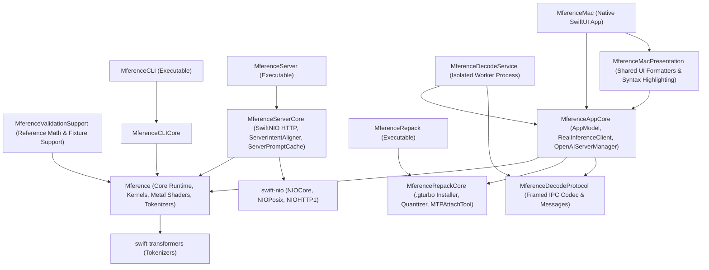

# Qwen 3.6 MTP, Lossless Weight Surgery & Whole-Program Architecture

> **Prominent Reference Document** for the `feat/qwen36-mtp-speculation` upgrades and the overall **Mference** Swift + Metal runtime architecture.

---

## Table of Contents

1. [Executive Overview & Measured Impact](#1-executive-overview-measured-impact)
2. [Part I — Multi-Token Prediction (MTP) & Hybrid Speculative Stack](#2-part-i-multi-token-prediction-mtp-hybrid-speculative-stack)
   - [MTP Sidecar Format & Extraction (`MTPAttachTool`)](#mtp-sidecar-format-extraction-mtpattachtool)
   - [Qwen 3.6 MTP Neural Block & Metal Execution (`Qwen36MTPSpeculator`)](#qwen-36-mtp-neural-block-metal-execution-qwen36mtpspeculator)
   - [Verify / Rollback / Seed Pipeline (`RealForwardRunner`)](#verify-rollback-seed-pipeline-realforwardrunner)
   - [Phase-Aware Adaptive Draft Depth (`K`)](#phase-aware-adaptive-draft-depth-k)
   - [Lossless Draft Expert Top-K Pruning (`moe.metal`)](#lossless-draft-expert-top-k-pruning-moemetal)
   - [EVICT-Style Margin Truncation (`logit.metal` & `LMHeadChainInt4`)](#evict-style-margin-truncation-logitmetal-lmheadchainint4)
   - [Hybrid PLD + MTP Speculation](#hybrid-pld-mtp-speculation)
   - [Prefill-Tail Expert Cache Warm Start](#prefill-tail-expert-cache-warm-start)
   - [Greedy MTP vs. Sampled Logits Switching](#greedy-mtp-vs-sampled-logits-switching)
3. [Part II — Lossless Resident Weight Surgery](#3-part-ii-lossless-resident-weight-surgery)
   - [Why It Is Bit-Exact on Quantized Payloads](#why-it-is-bit-exact-on-quantized-payloads)
   - [Surgery Parameters & Target Layers](#surgery-parameters-target-layers)
   - [Automatic MTP Co-Adaptation (`coAdaptMTP`)](#automatic-mtp-co-adaptation-coadaptmtp)
   - [Measured Surgery Profile on `scratch/qwen36-mtp.gturbo`](#measured-surgery-profile-on-scratchqwen36-mtpgturbo)
   - [CLI Invocation (`MferenceRepack --apply-surgery`)](#cli-invocation-mferencerepack---apply-surgery)
4. [Part III — Companion Generation, Alignment, Caching & App Wiring](#4-part-iii-companion-generation-alignment-caching-app-wiring)
   - [`RawCompletion`, `RepetitionLoopDetector` & Soft-Landing Thinking](#rawcompletion-repetitionloopdetector-soft-landing-thinking)
   - [Tokenization & Tool Call Hardening (`MFTokenizer`, `QwenToolCallParser`, `StructuredAssistantDecoder`)](#tokenization-tool-call-hardening-mftokenizer-qwentoolcallparser-structuredassistantdecoder)
   - [`ServerIntentAligner`](#serverintentaligner)
   - [Multi-Slot LRU `ServerPromptCache` & `PrefixSnapshot`](#multi-slot-lru-serverpromptcache-prefixsnapshot)
   - [Default App, OpenAI Server & WebUI Synchronization](#default-app-openai-server-webui-synchronization)
5. [Part IV — Measured AA Scorecard Results & Operational Safety](#5-part-iv-measured-aa-scorecard-results-operational-safety)
   - [Artificial Analysis Methodology A/B Comparison](#artificial-analysis-methodology-ab-comparison)
   - [Per-Task Telemetry Breakdown (`upgraded` vs. `baseline`)](#per-task-telemetry-breakdown-upgraded-vs-baseline)
   - [16 GiB Unified-Memory Safety (`DCPEXT0` Avoidance)](#16-gib-unified-memory-safety-dcpext0-avoidance)
6. [Part V — Whole Program Architecture (`Mference`)](#6-part-v-whole-program-architecture-mference)
   - [SwiftPM Products & Module Dependency Graph](#swiftpm-products-module-dependency-graph)
   - [End-to-End Runtime Diagram](#end-to-end-runtime-diagram)
   - [On-Disk `.gturbo` Storage Layout & Supported Families](#on-disk-gturbo-storage-layout-supported-families)
   - [Core Runtime Layers (`Sources/Mference/`)](#core-runtime-layers-sourcesmference)
   - [Front-Ends & User Surfaces](#front-ends-user-surfaces)
   - [Test & Verification Suite](#test-verification-suite)

---

## 1. Executive Overview & Measured Impact

The Qwen 3.6 35B-A3B (`256` experts, `topK = 8`, `40` hybrid Gated-DeltaNet + full-attention layers) upgrade transforms a raw, un-speculated checkpoint that looped/timed out in `<think>` into a verified speculative MoE stack combining:

1. **Native 19-Tensor MTP Draft Sidecar** (`packed_experts_mtp/layer_00.bin` + 17 resident `mtp.*` tensors in `model_weights.bin`) packaged by [`MTPAttachTool.swift`](Sources/MferenceRepack/Core/Workflow/MTPAttachTool.swift) and executed by [`Qwen36MTPSpeculator.swift`](Sources/Mference/Runtime/Inference/Qwen36MTPSpeculator.swift).
2. **Lossless Resident Weight Surgery** operating purely on `BF16` norms and `INT4`/`INT8` affine `scale`/`bias` tables inside `model_weights.bin` — **zero weight nibble re-quantization** — with automatic co-adaptation of the attached MTP draft block.
3. **Speculative Systems Optimizations** across [`moe.metal`](Sources/Mference/Metal/MoE/moe.metal), [`logit.metal`](Sources/Mference/Metal/Sampling/logit.metal), [`LMHeadChainInt4.swift`](Sources/Mference/Kernels/Fusions/LMHeadChainInt4.swift), [`Qwen36MTPSpeculator.swift`](Sources/Mference/Runtime/Inference/Qwen36MTPSpeculator.swift), and [`RealForwardRunner.swift`](Sources/Mference/Runtime/Inference/RealForwardRunner.swift):
   - Lossless draft expert top-K pruning (`topK = 4/6/8`)
   - EVICT-style top-1 vs. top-2 logit-margin truncation
   - Phase-aware adaptive `K` scheduling (`.thinking`, `.visibleProse`, `.structuredCodeOrTool`)
   - Zero-cost Hybrid Prompt Lookup Decoding (PLD) 3-gram/4-gram continuation matching for verbatim tool/code spans
   - Prefill-tail expert cache warm starting + fused post-norm greedy head reuse
   - Memory-bounded 2-slot LRU KV + GDN `PrefixSnapshot` prompt caching
4. **Accuracy & Stability Guards** across [`RawCompletion.swift`](Sources/Mference/Runtime/Generation/RawCompletion.swift), [`Sampler.swift`](Sources/Mference/Runtime/Generation/Sampler.swift), [`Tokenizer.swift`](Sources/Mference/Tokenization/Tokenizer.swift), [`StructuredAssistantDecoder.swift`](Sources/Mference/Tokenization/StructuredAssistantDecoder.swift), [`QwenToolCallParser.swift`](Sources/Mference/Tokenization/QwenToolCallParser.swift), and [`ServerInference.swift`](Sources/MferenceServer/Core/ServerInference.swift).

On the 8-task Artificial Analysis methodology A/B suite (`Scripts/eval_aa_scorecard.py`, 32 expert slots, `--max-new 512`, `--temperature 0`, recorded in [`benchmarks/aa-scorecard-v2.json`](benchmarks/aa-scorecard-v2.json)):

- **Pass@1 Intelligence:** `25.0% (2/8)` baseline → **`100.0% (8/8)` upgraded**
- **Aggregate Decode Speed:** `15.96 tok/s` baseline → **`16.47 tok/s` upgraded** (up to `18.36 tok/s` on Swift coding)
- **MTP Acceptance Rate:** `79.1%` static baseline → **`83.1%` adaptive hybrid upgraded** (`avg_K_emitted = 2.55`, `avg_K_drafted = 1.87`)
- **Average Time per Task:** `32.14s` → **`25.31s`** (`13.11s` average Time to First Answer Token across `8/8` completed tasks)

---

## 2. Part I — Multi-Token Prediction (MTP) & Hybrid Speculative Stack

### MTP Sidecar Format & Extraction (`MTPAttachTool`)

Implemented in [`MTPAttachTool.swift`](Sources/MferenceRepack/Core/Workflow/MTPAttachTool.swift) and exposed via [`Sources/MferenceRepack/Command/main.swift`](Sources/MferenceRepack/Command/main.swift):

```bash
swift run -c release MferenceRepack \
  --attach-mtp scratch/guru87_qwen36_mtp.safetensors \
  --output scratch/qwen36-mtp.gturbo
```

When attaching a Hugging Face `BF16` MTP shard to a Qwen 3.6 `.gturbo` directory:

1. **Validation First:** Verifies `arch.family == "qwen36"`, hidden dimensions (`d = 2048`, `moeF = 512`, `sharedF = 512`, `numHeads = 16`, `numKVHeads = 2`, `headDim = 256`, `numExperts = 256`), and checks all existing files in `manifest.json` before mutating anything.
2. **17 Resident `mtp.*` Tensors Appended to `model_weights.bin`:**
   - **Zero-Centered Norm Conversion:** HF checkpoints store Qwen RMSNorm weights zero-centered; `MTPAttachTool` converts `w -> w + 1.0` in `BF16` (`addOne: true`) matching trunk runtime expectations:
     - `mtp.pre_fc_norm_embedding.weight`, `mtp.pre_fc_norm_hidden.weight`, `mtp.norm.weight` (`BF16 [2048]`)
     - `mtp.layers.0.input_layernorm.weight`, `mtp.layers.0.post_attention_layernorm.weight` (`BF16 [2048]`)
     - `mtp.layers.0.self_attn.q_norm.weight`, `mtp.layers.0.self_attn.k_norm.weight` (`BF16 [256]`)
   - **Group-64 Affine Quantization:** Projections are encoded via `Int4AffineEncoder` (`INT4` group-64) or `Int8AffineEncoder` (`INT8` group-64 for routers/scalar gates):
     - `mtp.fc.weight` (`INT4 [2048, 4096]`)
     - `mtp.layers.0.self_attn.q_proj.weight` (`INT4 [8192, 2048]`, packed `Q` + gate), `k_proj.weight` (`INT4 [512, 2048]`), `v_proj.weight` (`INT4 [512, 2048]`), `o_proj.weight` (`INT4 [2048, 4096]`)
     - `mtp.layers.0.mlp.gate.weight` (`INT8 [256, 2048]`), `mtp.layers.0.mlp.shared_expert_gate.weight` (`INT8 [1, 2048]`)
     - `mtp.layers.0.mlp.shared_expert.{gate_proj,up_proj,down_proj}.weight` (`INT4`, `512` intermediate)
   - **In-Place Index Update:** When the grown 72-byte entry + string table still fits inside the existing page-padded index region (`81,920` bytes in `qwen36-mtp.gturbo`), `MTPAttachTool` appends only the new resident payload (`~21.37 MiB`) and rewrites the index in place; otherwise it rebuilds cleanly into a temporary file and swaps atomically.
3. **Auxiliary Routed Expert Pool (`packed_experts_mtp/layer_00.bin`):**
   - Extracts `mtp.layers.0.mlp.experts.gate_up_proj` (`[256, 1024, 2048]`) and `down_proj` (`[256, 2048, 512]`), quantizes each expert's `gate`/`up`/`down` matrices to `INT4` affine group-64, and writes `256` page-aligned expert blobs (`1,769,472` bytes/expert, `452,984,832` bytes total) to `packed_experts_mtp/layer_00.bin`.
4. **Manifest & Receipt Refresh:** Updates `manifest.json` with:
   - `sidecars.mtp = { "carried": true, "tensorCount": 19 }`
   - `auxiliaryExpertPools = [{ "name": "mtp", "directory": "packed_experts_mtp", "expertsPerLayer": 256, "expertStride": 1769472, "layers": [{ "layer": 0, "file": "layer_00.bin" }] }]`
   - Updated `files["model_weights.bin"]` & `files["packed_experts_mtp/layer_00.bin"]` SHA-256 digests, followed by regenerating `verified-install.json` via `VerifiedInstallTool`.

### Qwen 3.6 MTP Neural Block & Metal Execution (`Qwen36MTPSpeculator`)

Implemented in [`Qwen36MTPSpeculator.swift`](Sources/Mference/Runtime/Inference/Qwen36MTPSpeculator.swift) conforming to [`SpeculativeDrafter`](Sources/Mference/Runtime/Inference/SpeculativeDrafter.swift):

1. **Auto-Probing:** [`RealForwardRunner.probeQwen36Speculator`](Sources/Mference/Runtime/Inference/RealForwardRunner.swift) automatically arms `Qwen36MTPSpeculator` for `.qwen36` models whenever `manifest.sidecars["mtp"].carried == true` (unless `MFERENCE_SPEC=off`, `MFERENCE_MTP=0`, or `MFERENCE_SPEC=pld`).
2. **Draft Forward Graph (`runSingleDraftStep`):**
   - Shared `model.embedding` lookup for the draft token → `pre_fc_norm_embedding` concatenated with `pre_fc_norm_hidden(prevHidden)` → `fc.weight` (`[2*d -> d]`)
   - Pre-norm full attention (`q_proj` splits `q` + sigmoid `gate`, per-head `q_norm`/`k_norm`, NeoX sub-dimension RoPE with `partialRotaryFactor = 0.25`, `mtpK`/`mtpV` private GPU KV cache, sigmoid attention gate multiply, `o_proj`, residual add)
   - Post-attention RMSNorm → router (`draftTopK` experts) + `ResidentExpertStreamer(strategy: .mapped)` slab lookup on `packed_experts_mtp/layer_00.bin` in parallel with scalar-gated `SharedExpertRuntime` (`shared_expert_gate` sigmoid scalar multiply) + `MoE.encodeSlotMapGuardedFFN`
   - `mtp.norm.weight` → shared `model.lmHead` via `LMHeadChainInt4.encodeGreedyFromNormed` (producing next draft token + `lastTop1Margin` in one command buffer).
3. **Control Flags:**
   - `MFERENCE_SPEC=off|mtp|pld`, `MFERENCE_MTP=0|1`, `MFERENCE_PLD=1`
   - `MFERENCE_SPEC_K` / `MFERENCE_MTP_K` (`1..4` or `auto`)
   - `MFERENCE_SPEC_ADAPTIVE=0|1`
   - `MFERENCE_MTP_TOP_K` (`4|6|8`)
   - `MFERENCE_MTP_MIN_MARGIN` (float margin override for EVICT truncation)
   - `MFERENCE_MTP_PLD=0` (disable hybrid PLD)

### Verify / Rollback / Seed Pipeline (`RealForwardRunner`)

```mermaid
sequenceDiagram
    participant Loop as "RawCompletion Decode Loop"
    participant Runner as "RealForwardRunner"
    participant Spec as "Qwen36MTPSpeculator"
    Loop->>Runner: "produce(token: bonus, position)"
    alt "pending token exists"
        Runner->>Spec: "consumePending()"
        Spec-->>Runner: "next verified token (zero GPU work)"
    else "run verify round (greedyIfAvailable)"
        Runner->>Spec: "draft(bonus, position, count: draftK)"
        Spec-->>Runner: "drafts[0..<K] (uses precomputed seedToken + PLD/MTP)"
        Runner->>Runner: "executePrefillChunk([bonus] + drafts, isVerifyPass: true)"
        Note over Runner: "Batched LMHeadGreedyMultiX checks K+1 positions"
        alt "accepted < drafts.count"
            Runner->>Runner: "kv.rewind() + restoreGDNFromVerifyArena(slot: accepted)"
        end
        Runner->>Spec: "commitAcceptPass(emitted, targetNormedHidden, acceptedCount)"
        Note over Spec: "Batch-syncs MTP KV + precomputes next round seedToken & seedMargin"
    end
```

Key design wins in [`RealForwardRunner.swift`](Sources/Mference/Runtime/Inference/RealForwardRunner.swift) and [`Qwen36MTPSpeculator.swift`](Sources/Mference/Runtime/Inference/Qwen36MTPSpeculator.swift):

- **4-Slot GDN Rollback Arena:** Captures snapshots of the Gated-DeltaNet recurrent + conv states during the batched verify pass so rejecting draft token `accepted < K` rolls back both full-attention KV (`kv.rewind`) and hybrid linear-attention GDN state without recomputing accepted prefix positions.
- **Async-Pipelined Next-Round Seed (`commitAcceptPass`):** Submits the batched MTP accept pass asynchronously (`pendingAcceptCB`), simultaneously updating `mtpK`/`mtpV` for all newly committed `(hidden, token)` pairs and running `mtp.norm` + `draftHead.encodeGreedyFromNormed` for the next round's `seedToken`/`seedMargin` while CPU detokenization and SSE streaming proceed; `flushPendingAcceptIfNeeded()` synchronizes deterministically before any subsequent `draft`, continuation, reset, stats read, or write to `lastHiddenBuf`. Also safely resets `firstMissing = position - 1` whenever `mtpLen + missingCount > maxContext` wraps the MTP KV buffer.
- **Zero-Blit MTP Execution & Parallel Verify Routing:** Draft and accept passes write `k_proj`/`v_proj` directly into `mtpK`/`mtpV` (`slotOffset` / `startSlot * kvBytes`) without intermediate KV buffers or `kvBlit` passes; `encodeAcceptPass` batches Q/K per-head norms + NeoX RoPE in one `PrefillQKVEpilogue.encodeNeoxSubdimNoVNorm` call; verify (`t <= 4`) and accept routing use parallel `MoE.encodeRouterGemma4` instead of `PrefillRouter`; `ResidentExpertStreamer(..., slabOnly: true)` skips 256 unused per-expert `MTLBuffer` wrappers and sets `POSIX_MADV_RANDOM` on `packed_experts_mtp/layer_00.bin`; and `produceToken` / prefill compute final RMSNorm once into `mtp.lastHiddenBuf` via `LMHeadChainInt4.encodeGreedyFromNormed` (or `int4.encode`).

### Phase-Aware Adaptive Draft Depth (`K`)

[`Qwen36MTPSpeculator`](Sources/Mference/Runtime/Inference/Qwen36MTPSpeculator.swift) tracks generation phases directly from Qwen 3.6 ChatML/markdown token IDs (`notifyTokens` & `recordAccepted`):

- `<think>` (`248068`) → `.thinking`
- `</think>` (`248069`), `</tool_call>` (`248059`), `<|im_start|>`, `<|im_end|>`, `<|endoftext|>` → `.visibleProse`
- `<tool_call>` (`248058`), or visible code fences ` ``` ` (`71093`, `52451`) → `.structuredCodeOrTool`

Behavior in `recommendedDraftCount(maxSlotSupportedK:)`:

- Maintains rolling per-position acceptance EMAs (`emaPositionAccept`, `alpha = 0.20`).
- On transitions out of `<think>` into `.visibleProse` or `.structuredCodeOrTool`, `notifyPhaseTransition(_:)` immediately lifts the EMA floor (`[0.90, 0.78, ...]` for prose; `[0.94, 0.86, ...]` for code/tools) so `K` recovers without slow warmup lag.
- Drops to `K = 1` when `p0`/`p1` fall below threshold (`0.58`/`0.34` in code/tools; `0.62`/`0.38` in prose/thinking).
- **Hardware Slot Ceiling & Anti-Verify-Tax Cap:** `RealForwardRunner.produce` sets `slotCap = slots >= 48 ? min(3, rawCap) : min(2, rawCap)`, and `recommendedDraftCount` only steps to `K = 3` when `cap >= 3` and EMAs are very high (`p0 >= 0.92`, `p1 >= 0.88`, `p2 >= 0.72`). Further bounded by `specMaxDraftSlotCapOverride` (see [`ServerIntentAligner.recommendedMaxSlotSupportedK`](Sources/MferenceServer/Core/ServerInference.swift)). Both `ServerModelSession` and `RealInferenceClient` enable `specAdaptiveDraftOverride = true` automatically for Qwen 3.6 + MTP.

### Lossless Draft Expert Top-K Pruning (`moe.metal`)

- [`Sources/Mference/Metal/MoE/moe.metal`](Sources/Mference/Metal/MoE/moe.metal) adds one-SIMD top-K softmax selection kernels `router_topk_select_k4_par` and `router_topk_select_k6_par` alongside `k8` and `k10`.
- [`Sources/Mference/Kernels/MoE/MoE.swift`](Sources/Mference/Kernels/MoE/MoE.swift) widens `routedComputeWidths` and `routerTopKWidths` to `{4, 6, 8, 10}`.
- `Qwen36MTPSpeculator` initializes `draftTopK` from `MFERENCE_MTP_TOP_K` (`4`, `6`, or `8`), defaulting to `6` when `topK >= 6`.
- **Mathematically Lossless:** Pruning routed experts inside the draft module (`mtp.layers.0`) affects only draft proposals; every emitted token is still verified by the full `topK = 8` trunk.

### EVICT-Style Margin Truncation (`logit.metal` & `LMHeadChainInt4`)

- [`Sources/Mference/Metal/Sampling/logit.metal`](Sources/Mference/Metal/Sampling/logit.metal) sets `kLMHeadSingleRowSummaryStride = 3` so `lm_head_greedy_int4_rows_chunk_raw` tracks each 8-row threadgroup's runner-up (`slot[2] = r_all`), and `lm_head_greedy_int4_rows_reduce` folds both chunk winners and `tg_second` into exact global `max(0.0, top1 - top2)` written at `summaries[0]`.
- [`LMHeadChainInt4.lastTop1Margin`](Sources/Mference/Kernels/Fusions/LMHeadChainInt4.swift) reads this zero-copy shared float margin immediately after command completion.
- `Qwen36MTPSpeculator.shouldTruncateAfterFirstDraft` truncates draft depth to `K = 1` (skipping sequential draft step 2 and reducing MoE verify bandwidth) when `draft[0]` lands on a control/phase token (`>= 248044`, `<think>`, `</think>`, `<tool_call>`, `</tool_call>`) or when `firstMargin < threshold` (`1.10` in `.thinking`/`.visibleProse`; `min(0.25, 1.10 * 0.45)` in `.structuredCodeOrTool`), **unless** PLD uniquely confirms `draft[0]`.

### Hybrid PLD + MTP Speculation

Implemented in [`Qwen36MTPSpeculator.swift`](Sources/Mference/Runtime/Inference/Qwen36MTPSpeculator.swift) (`pldUniqueContinuation`):

- When `historyAligned` is true during `.structuredCodeOrTool`, `<tool_call>`, or fenced code blocks (`tokenHistory` tracks code fences via Qwen tokens `71093`/`52451` and tool spans via `notifyTokens` without double-toggling on closing fences):
  1. Executes a zero-allocation single-pass backward scan over `tokenHistory` tracking uniqueness across **6-, 5-, 4-, and 3-grams** simultaneously (disambiguating repeated 4-grams with 5/6-gram context).
  2. Checks if a unique continuation agrees on `draft[0]` (`pldConfirmsFirst`), preventing EVICT truncation even on tight margins, and populates `draft[1]` (and `draft[2]` if `K >= 3`) directly from prompt/context history **without executing extra sequential `mtp.layers.0` Metal passes**.
- Snapshot-aware: `PrefixSnapshot` in `RealForwardRunner` saves and restores `Qwen36MTPSpeculator.capturedTokenHistory` across LRU cache switches so PLD remains consistent across multi-turn chats.

### Prefill-Tail Expert Cache Warm Start

Implemented in [`RealForwardRunner.swift`](Sources/Mference/Runtime/Inference/RealForwardRunner.swift) and [`PreadExpertStreamer.swift`](Sources/Mference/Infrastructure/Streaming/PreadExpertStreamer.swift):

- Controlled by `MFERENCE_PREFILL_TAIL_WARM != "0"`.
- On final prompt chunks (`writeFinalHead && !isVerifyPass`), inspects routed experts for the last 3 prompt tokens (`nearTailExperts`) and final token (`lastTokenExperts`):
  - Tags `PrefillMoEGrouping` `expertSortKeys` with high-bit ordering (`1 << 61` for `nearTailExperts`, `1 << 62` for `lastTokenExperts`) so tail experts run in the last prefill tiles and remain resident at chunk end instead of being evicted mid-prefill.
  - Calls `streamer.noteAllHitUse(experts: nearTailExperts)` after tile draining so LFU/LRU slot metadata preserves tail experts for decode round 1.
  - Seeds `recordRoutedExperts(lastTokenExperts, layer: L)` for shadow prefetch continuity.

### Greedy MTP vs. Sampled Logits Switching

- [`RawCompletion.swift`](Sources/Mference/Runtime/Generation/RawCompletion.swift) sets `fusedGreedy = (fusedRunner?.usesFusedGreedyHead == true) && config.isPureGreedy` (`temperature == 0 && repetitionPenalty == 1`) and calls `fusedRunner?.setOutputMode(fusedGreedy ? .greedyIfAvailable : .logits)`.
- [`RealForwardRunner.produce`](Sources/Mference/Runtime/Inference/RealForwardRunner.swift) runs MTP/PLD verification only when `useFusedGreedyHead && activeOutputMode == .greedyIfAvailable`. Any request with `temperature > 0` or `repetitionPenalty != 1` seamlessly switches to full-vocab `.logits` sampling via [`Sampler.swift`](Sources/Mference/Runtime/Generation/Sampler.swift) without reloading weights inside `MferenceServer`.

---

## 3. Part II — Lossless Resident Weight Surgery

### Why It Is Bit-Exact on Quantized Payloads

Implemented in [`MTPAttachTool.applyResidentWeightSurgery`](Sources/MferenceRepack/Core/Workflow/MTPAttachTool.swift):

Mference stores MLX group-64 affine quantized weights as:

$$w_{i,g,j} = s_{i,g} \cdot q_{i,g,j} + b_{i,g}$$

where $q_{i,g,j} \in [0, 15]$ (4-bit) or $[0, 255]$ (8-bit) are packed nibbles/bytes and $(s_{i,g}, b_{i,g})$ are `BF16` per-group scale and bias tables. Multiplying a projection's output by $\alpha$ transforms linearly into:

$$\alpha \cdot w_{i,g,j} = (\alpha \cdot s_{i,g}) \cdot q_{i,g,j} + (\alpha \cdot b_{i,g})$$

**No nibble payload $q$ is ever unpacked, re-rounded, or re-quantized.** Only `BF16` norm vectors (`dtype == 1`) and `BF16` affine `scale`/`bias` regions (`dtype == 0`) are scaled on an APFS copy-on-write `.surgery.tmp` clone, `fsync`ed, hashed, and atomically swapped over `model_weights.bin`.

### Surgery Parameters & Target Layers

| `SurgeryConfig` Field | CLI Flag | Default | Target Tensors & Layer Scope | Purpose |
| :--- | :--- | ---: | :--- | :--- |
| `finalNormScale` | `--surgery-final-norm` | `1.0` | `final_norm.weight` / `*.model.norm.weight` | Adjusts final logit temperature before `lm_head` |
| `qkNormScale` | `--surgery-qk-norm` | `1.0` | `.q_norm.weight`, `.k_norm.weight` on layers $\ge$ `qkNormStartLayerRatio * L` | Sharpens late full-attention Q/K magnitude |
| `qkNormStartLayerRatio` | `--surgery-qk-start-ratio` | `0.5` | Layer index threshold ratio (`0.0...1.0`) | Controls start depth for Q/K norm scaling |
| `routerTemperature` | `--surgery-router-temp` | `1.0` | `.mlp.gate.weight` (multiplies scale & bias by $1 / T$) on layers $\ge$ `lateLayerStartFraction * L` | Sharpens MoE router gating logits ($T < 1$) |
| `lateLayerResidualScale` | `--surgery-late-residual` | `1.0` | `.self_attn.o_proj.weight`, `.attn.o_proj.weight`, `.mlp.down_proj.weight` on layers $\ge$ `lateLayerStartFraction * L` | Damps late full-attention / dense contributions to suppress loops |
| `lateLinearResidualScale` | `--surgery-late-linear-residual` | `1.0` | `.linear_attn.out_proj.weight` on layers $\ge$ `lateLayerStartFraction * L` | Optional late Gated-DeltaNet output residual scaling |
| `lateLayerStartFraction` | `--surgery-late-start-ratio` | `0.75` | Layer index threshold ratio (`0.0...1.0`) | Controls start depth for late attention/router surgery |
| `sharedExpertScale` | `--surgery-shared-expert` | `1.0` | `.shared_expert.down_proj.weight` on layers $\ge$ `sharedExpertStartLayerRatio * L` | Boosts the always-active dense shared expert independently of late damping |
| `sharedExpertStartLayerRatio` | `--surgery-shared-expert-start-ratio` | `0.5` | Layer index threshold ratio (`0.0...1.0`) | Anchors logical coherence & schema adherence from mid layers upward |
| `allowReapply` | `--surgery-force` / `--overwrite` | `false` | Checked against `manifest.json["surgery"]` | Prevents accidental double-application of scales |

### Automatic MTP Co-Adaptation (`coAdaptMTP`)

When `coAdaptMTP == true` (default, disable with `--surgery-no-coadapt-mtp`):

- `mtp.norm.weight` is scaled by `finalNormScale * mtpNormScale` so the MTP head's logits entering the shared `lm_head` match the trunk's calibrated temperature.
- `mtp.pre_fc_norm_hidden.weight` is **not** multiplied by `finalNormScale` because $\text{RMSNorm}(\alpha \cdot h) = \text{RMSNorm}(h)$ is already scale-invariant; it uses only explicit `mtpHiddenNormScale` (`--surgery-mtp-hidden-norm`).
- `mtp.layers.0.self_attn.{q_norm,k_norm}.weight`, `mtp.layers.0.mlp.gate.weight`, `mtp.layers.0.mlp.shared_expert.down_proj.weight`, and `mtp.layers.0.self_attn.o_proj.weight` inherit trunk `qkNormScale`, `routerTemperature`, `sharedExpertScale`, and `lateLayerResidualScale` (or explicit `--surgery-mtp-*` overrides).

### Measured Surgery Profile on `scratch/qwen36-mtp.gturbo`

Direct binary comparison of `scratch/qwen36-mtp.gturbo/model_weights.bin` (`630` resident tensors, `1,411,880,320` bytes) against unmodified `scratch/qwen36.gturbo/model_weights.bin` (`613` resident tensors, `1,389,476,096` bytes) confirms the exact active surgery profile on disk (median BF16 element/scale ratios across tensors):

- **`finalNormScale` (`language_model.model.norm.weight`):** `1.0188x` ($\approx 1.02$ in BF16)
- **`qkNormScale` (`layers >= 20` full-attention `q_norm`, e.g. layer `23`):** `1.0299x` ($\approx 1.03$; layer `19` = `1.0000x`)
- **`lateLayerResidualScale` (`layers >= 30` `self_attn.o_proj`, e.g. layer `31`):** `0.9799x` ($\approx 0.98$)
- **`routerTemperature` (`layers >= 30` `mlp.gate`, e.g. layer `31`):** `1.0429x` ($\approx 1 / 0.96 = 1.0417$, i.e. $T = 0.96$)
- **`sharedExpertScale` (`layers >= 20` `mlp.shared_expert.down_proj`, layers `20..39`):** `1.0250x` (layer `19` = `1.0000x`)

### CLI Invocation (`MferenceRepack --apply-surgery`)

`applyResidentWeightSurgery` validates that all active scale/temperature values are finite positive numbers (and layer ratios lie in `0.0...1.0`), refuses accidental re-application when `manifest.json["surgery"]` is already present unless `--surgery-force` or `--overwrite` is passed, stages mutations on a `.surgery.tmp` clone, swaps atomically via `rename`, records full surgery parameters in `manifest.json["surgery"]`, recomputes the `SHA-256` of `model_weights.bin`, atomically writes updated `manifest.json`, removes stale `verified-install.json`, and regenerates a valid install receipt (propagating verification failures):

```bash
swift run -c release MferenceRepack \
  --apply-surgery \
  --input-gturbo scratch/qwen36-mtp.gturbo \
  --surgery-final-norm 1.02 \
  --surgery-qk-norm 1.03 \
  --surgery-qk-start-ratio 0.5 \
  --surgery-router-temp 0.96 \
  --surgery-late-residual 0.98 \
  --surgery-late-start-ratio 0.75 \
  --surgery-shared-expert 1.025 \
  --surgery-shared-expert-start-ratio 0.5
```

---

## 4. Part III — Companion Generation, Alignment, Caching & App Wiring

### `RawCompletion`, `RepetitionLoopDetector` & Soft-Landing Thinking

- **`RepetitionLoopDetector`** ([`Sampler.swift`](Sources/Mference/Runtime/Generation/Sampler.swift)): Suffix cycle detector (`1...maxPatternLength` up to `64` tokens, `minRepeats = 3`, requiring $\ge 4$ consecutive repeats for single-token runs to avoid breaking whitespace/ellipses).
  - Inside `<think>`, [`RawCompletion.swift`](Sources/Mference/Runtime/Generation/RawCompletion.swift) triggers soft-landing `</think>\n\n` injection if a thinking loop is detected after 24 thinking tokens.
  - Outside `<think>`, prepares `prepareForContinuation`, temporarily switches fused-greedy runners to `.logits` for one step, penalizes the cycle tokens in place via `Sampler.penalizeCycleInPlace`, samples a loop-breaking token, and resumes fast fused-greedy speculation.
  - Bounded `repetitionWindow` in `Sampler` prevents unbounded $O(N)$ history penalty scans on long contexts.
- **Clause-Aware Soft-Landing `<think>` ([`RawCompletion.swift`](Sources/Mference/Runtime/Generation/RawCompletion.swift)):**
  - When `maxThinkingTokens > 0` (`softRatio = maxThinkingTokens >= 300 ? 0.89 : 0.85`), once `thinkingTokensCount >= softThinkLimit`, waits for a clean clause/sentence boundary (`StructuredAssistantDecoder.isThinkingBoundaryDelta`) before injecting `</think>\n\n` (or cuts cleanly at hard `maxThinkingTokens`), calling `notifyMTPPhaseTransition(structuredCodeOrTool: false)` so MTP steps back up cleanly.

### Tokenization & Tool Call Hardening (`MFTokenizer`, `QwenToolCallParser`, `StructuredAssistantDecoder`)

- **[`Tokenizer.swift`](Sources/Mference/Tokenization/Tokenizer.swift):** Enables `generationPromptStartsInThinking` by default for `.qwen36` alongside `.qwen38` and `.maple` (`MFERENCE_QWEN36_THINKING=0` opts out), passing `enable_thinking: true, preserve_thinking: true` to `chat_template.jinja`.
- **[`QwenToolCallParser.swift`](Sources/Mference/Tokenization/QwenToolCallParser.swift):**
  - Repairs minor quantized JSON slips (`repairMinorJSONSlip` removes trailing commas before `}`/`]` and balances up to 2 unclosed trailing brackets).
  - Supports JSON fallback parsing (`{"name": ..., "arguments" | "parameters": ...}`) and schema-aware coercion (`booleanLiteral` `"true"`/`"false"` to JSON `.bool` when tool parameter schema declares `"type": "boolean"`).
- **[`StructuredAssistantDecoder.swift`](Sources/Mference/Tokenization/StructuredAssistantDecoder.swift):**
  - Deduplicates identical consecutive tool calls (`deduplicateConsecutiveToolCalls`) if the model retries the same tool signature immediately.
  - Recovers completed `<function=...>...</function>` XML/JSON blocks on truncation in `finish()`.

### `ServerIntentAligner`

Implemented in [`ServerInference.swift`](Sources/MferenceServer/Core/ServerInference.swift) (`MFERENCE_INTENT_ALIGN=0|off` disables):

- **Prompt Thinking Profile (`PromptThinkingProfile`):** Classifies requests into `.zeroThinkFastPath` (e.g., `reasoningEffort == .off`, explicit `MFERENCE_ZERO_THINK_FASTPATH=1`, `FINAL_ANSWER` visible-derivation requests, or short `<= 120`-char utility prefixes `"convert "`, `"format as json:"`, etc.), `.strictConstraint`, `.multiPartAlgorithmic`, or `.standard`.
- **`.zeroThinkFastPath` Injection (`applyZeroThinkFastPathIfNeeded`):** Appends `</think>\n\n` tokens directly to `promptIDs` when the rendered prompt ends inside an open `<think>`, eliminating `<think>` latency (`TTFAT`) on single-pass visible tasks.
- **`tunedGenerationConfig`:** Enables `loopGuardRepeats = 3` (`loopGuardPenalty >= 1.85`), `repetitionWindow = 128` when `repetitionPenalty != 1.0`, and proportional `maxThinkingTokens` headroom (e.g. `min(512, maxNewTokens * 7 / 16)` on standard `<= 768`-token budgets; `5/8` or `4/5` up to `768` for `.multiPartAlgorithmic` / `.strictConstraint`).
- **16 GiB Memory & Context Cap (`recommendedMaxSlotSupportedK`):** Uses `os_proc_available_memory()` (or `MFERENCE_AVAILABLE_MEMORY_MB`): caps speculative depth at `1` below `1.5 GiB` available RAM or `>= 3072` active context tokens, and at `<= 2` below `3.0 GiB` or `>= 1536` context tokens.

### Multi-Slot LRU `ServerPromptCache` & `PrefixSnapshot`

Implemented across [`ServerPromptCache.swift`](Sources/MferenceServer/Core/ServerPromptCache.swift), [`ServerInference.swift`](Sources/MferenceServer/Core/ServerInference.swift), and [`RealForwardRunner.swift`](Sources/Mference/Runtime/Inference/RealForwardRunner.swift):

- **Memory-Bounded Slots (`ServerPromptCache.recommendedMaxSlots`):** Allows **2 LRU slots** when `availableMemoryBytes > 2.5 GiB` (`2,560 MiB`), shrinking automatically to **1 slot** (`setMaxSlots`) under memory pressure.
- **Conversation Switching Without Re-Prefill (`PrefixSnapshot`):** When a second conversation hits an inactive slot (`hitSlotID != liveRunnerCacheEntryID`), `ServerModelSession` parks the live runner's linear KV layers, pinned GDN snapshot, and `Qwen36MTPSpeculator.capturedTokenHistory` into CPU `Data` (`capturePrefixSnapshot`), then restores the target slot (`restorePrefixSnapshot`) and resumes decode cleanly. Also pins a base prefix checkpoint after the first `<|im_end|>` turn boundary (`>= 32` tokens) so multi-turn branching inside a single slot rewinds GDN + KV without full re-prefill.

### Default App, OpenAI Server & WebUI Synchronization

Every runtime front-end was aligned so the upgraded model and MTP run out of the box:

- **Default Model Pointers:**
  - [`OpenAIServerManager.swift`](Sources/MferenceApp/Core/State/OpenAIServerManager.swift) (`resolveModelPath`) prefers `scratch/qwen36-mtp.gturbo` over `scratch/qwen36.gturbo`.
  - `com.mference.MferenceMac` `Mference.modelDirectory` default and `~/Library/Application Support/Mference/qwen36.gturbo` symlink point to `<repo>/scratch/qwen36-mtp.gturbo`.
- **Greedy-by-Default (`temperature = 0`) for MTP:**
  - [`OpenAIModels.swift`](Sources/MferenceServer/Core/OpenAIModels.swift) defaults omitted `request.temperature` to `0` instead of `0.2`.
  - [`Scripts/openwebui-configure-models.py`](Scripts/openwebui-configure-models.py) seeds `"temperature": 0.0` alongside `"builtin_tools": false` in Open WebUI model configuration.
  - [`scratch/mac-app-settings.json`](scratch/mac-app-settings.json) and `~/Library/Application Support/Mference/mac-app-settings.json` set `"temperature": 0`.
- **Native Mac App (`RealInferenceClient.swift`):** Enables `specAdaptiveDraftOverride = true`, dynamic prompt-length K cap (`promptIds.count >= 3072 ? 1 : 2`), and `loopGuardRepeats = 3` inside [`MferenceDecodeService`](Sources/MferenceDecodeService/Entry.swift).
- **Bundle Sync:** Rebuilt `.build/release/{MferenceMac,MferenceDecodeService,MferenceServer,MferenceCLI}`, synced binaries and `.bundle` Metal resources into `~/Applications/Mference.app/Contents/`, and ad-hoc re-signed with `codesign --force --deep --sign -`.

---

## 5. Part IV — Measured AA Scorecard Results & Operational Safety

### Artificial Analysis Methodology A/B Comparison

Reproducible harness: [`Scripts/eval_aa_scorecard.py`](Scripts/eval_aa_scorecard.py), results stored in [`benchmarks/aa-scorecard-v2.json`](benchmarks/aa-scorecard-v2.json). Both variants ran through a single long-lived release `MferenceServer` (`--max-context 4096 --expert-cache-slots 32 --prompt-cache-mode off --verify trusted-receipt`), `--max-new 512`, `--temperature 0`.

| Metric | Baseline (Static MTP `K=2`, Raw `1.0` Weights, No Guards) | Upgraded (`qwen36-mtp.gturbo` + Surgery + Adaptive Hybrid MTP + Guards) | Delta |
| :--- | ---: | ---: | ---: |
| **Pass@1 Score** | `25.0%` (`2/8`) | **`100.0%` (`8/8`)** | **`+75.0 pts`** |
| **Decode Speed** | `15.96 tok/s` | **`16.47 tok/s`** | **`+3.2%`** |
| **End-to-End Speed** | `13.84 tok/s` | `13.31 tok/s` | Prefill amortization on shorter completions |
| **Avg Time per Task** | `32.14s` | **`25.31s`** | **`-21.3%` (`-6.83s`)** |
| **Avg TTFAT (Answered)** | `17.62s` (`2/8` emitted) | **`13.11s` (`8/8` emitted)** | All `8/8` emit answers |
| **Avg Tokens / Task (Think + Visible)** | `413.4` + `31.3` = `444.6` | **`126.1` + `210.8` = `336.9`** | `-69.5%` think waste |
| **MTP Acceptance Rate** | `79.1%` | **`83.1%`** | **`+4.0 pts`** |
| **`avg_K_emitted` / `avg_K_drafted`** | `2.58` / `2.00` | `2.55` / `1.87` | Lower wasted draft work |

### Per-Task Telemetry Breakdown (`upgraded` vs. `baseline`)

| ID | Category | Task | Baseline | Upgraded | Upgraded Decode | Upgraded MTP Accept |
| :--- | :--- | :--- | :--- | :--- | ---: | ---: |
| `C1` | Coding | Interval Uncovered Spans (Python) | FAIL (`512` think, `0` vis) | **PASS** (`191` think / `220` vis) | `17.46 tok/s` | `81.3%` (`avgK=2.57`) |
| `C2` | Coding | Shortest Subarray `>= K` (Swift) | FAIL (`512` think, `0` vis) | **PASS** (`206` think / `249` vis) | `18.36 tok/s` | `82.1%` (`avgK=2.51`) |
| `M1` | Reasoning | AIME Weighted Power Sum Mod `1000` | FAIL (`512` think, `0` vis) | **PASS** (`0` think / `511` vis) | `17.88 tok/s` | `94.3%` (`avgK=2.85`) |
| `M2` | Reasoning | GPQA Thermo Linear P-V Crossover | FAIL (`512` think, `0` vis) | **PASS** (`0` think / `207` vis) | `17.71 tok/s` | `77.4%` (`avgK=2.40`) |
| `I1` | Instruction | IFBench Strict JSON Schema & Negatives | FAIL (`512` think, `0` vis) | **PASS** (`285` think / `151` vis) | `14.50 tok/s` | `82.1%` (`avgK=2.48`) |
| `I2` | Instruction | IFBench 3-Bullet Partitioning Prose | FAIL (`512` think, `0` vis) | **PASS** (`289` think / `92` vis) | `15.30 tok/s` | `75.5%` (`avgK=2.33`) |
| `A1` | Agentic Tool | `patch_file` Recovery (bool coercion) | PASS (`79` think / `141` vis) | **PASS** (`38` think / `147` vis) | `14.33 tok/s` | `83.3%` (`avgK=2.64`) |
| `A2` | Agentic Tool | `exec_command` Triage (array/int/obj) | PASS (`156` think / `109` vis) | **PASS** (`0` think / `109` vis) | `15.16 tok/s` | `88.5%` (`avgK=2.77`) |

*(Note: Baseline and standalone earlier benchmarks exist in [`benchmarks/baseline-qwen36-golden.json`](benchmarks/baseline-qwen36-golden.json) and [`benchmarks/test-attached-mtp-reasoning.json`](benchmarks/test-attached-mtp-reasoning.json).)*

### 16 GiB Unified-Memory Safety (`DCPEXT0` Avoidance)

- **One Model Owner Rule ([`AGENTS.md`](AGENTS.md)):** Never run concurrent model-owning processes or repeatedly spawn `MferenceCLI` in a Python/shell loop on a `16 GiB` unified-memory Mac; rapidly wiring and tearing down `2.75+ GiB` of resident Metal buffers triggers macOS display/GPU memory pressure (`DCPEXT0` panics). Multi-prompt workloads must reuse one long-lived `MferenceServer` or `MferenceDecodeService` session.
- **Expert Cache Sizing:** Keep `--expert-cache-slots` at `32–48` (`ServerArguments` default = `48`) when running alongside heavy apps on 16 GiB Macs.

---

## 6. Part V — Whole Program Architecture (`Mference`)

### SwiftPM Products & Module Dependency Graph

Defined in [`Package.swift`](Package.swift) (Swift tools `6.1`, platforms `.macOS(.v15)` / `.iOS(.v18)`):



### End-to-End Runtime Diagram

```mermaid
flowchart LR
    subgraph Frontends["Front-Ends"]
        App["Mference.app (MferenceMac -> MferenceDecodeService)"]
        Server["MferenceServer (OpenAI HTTP / SSE / --library)"]
        WebUI["Mference WebUI.app / mference-ui.sh (Open WebUI 0.11.3)"]
        CLI["MferenceCLI"]
        WebUI --> Server
        App -. "Start OpenAI Server" .-> Server
    end

    subgraph Orchestration["Prompt, Alignment & Caching"]
        Aligner["ServerIntentAligner / AppModel"]
        Tokenizer["MFTokenizer + ChatML / Jinja / Native Dialects"]
        Cache["ServerPromptCache (LRU) + PrefixSnapshot"]
        Loop["RawCompletion + Sampler + RepetitionLoopDetector + StructuredAssistantDecoder"]
    end

    subgraph Execution["Forward Runners & Speculation"]
        Factory["ForwardRunnerFactory"]
        Runners["RealForwardRunner / Qwen38 / FlashNext / Glm53 / MiniCPM5 / Maple"]
        Spec["Qwen36MTPSpeculator (MTP + Hybrid PLD + EVICT + Top-K Prune) / DFlash2 / Qwen38MTP"]
        KV["KVCacheManager / GDNStateManager / KVPageStore / DSV4 & Glm53 State"]
    end

    subgraph GPU_Storage["Metal 3+ & Bounded Storage"]
        Metal["Metal Kernels (MoE, Attention, GDN, Prefill TensorOps2D, LMHeadChainInt4, Sampling)"]
        Weights["resident mmap model_weights.bin (INT4/INT8 g64 + BF16 norms)"]
        Stream["PreadExpertStreamer (SSD slot cache + RDADVISE) + ResidentExpertStreamer (MTP mmap)"]
    end

    Frontends --> Orchestration --> Execution --> GPU_Storage
```



### On-Disk `.gturbo` Storage Layout & Supported Families

Every model directory uses the self-describing `.gturbo` format:

```text
<model>.gturbo/
  manifest.json               # ArchConfig, flags, sidecars (mtp), auxiliaryExpertPools, SHA-256 file map
  verified-install.json       # Cryptographic install receipt (directory + manifest + sizes)
  model_weights.bin           # 16 KiB-aligned resident index + resident weights (INT4/INT8 g64 & BF16 norms)
  packed_experts/
    layout.json               # Expert tensor sub-offsets inside fixed page-aligned stride
    layer_XX.bin              # Streamed routed experts per MoE layer
  packed_experts_mtp/         # Optional Qwen 3.6 MTP auxiliary routed expert pool
    layer_00.bin              # 256 page-aligned INT4 experts (~453 MB)
  tokenizer/
    config.json, tokenizer.json, tokenizer_config.json, chat_template.jinja, ...
```

Supported families declared in [`ModelTypes.swift`](Sources/Mference/Infrastructure/ModelIO/ModelTypes.swift) and routed by [`ForwardRunnerFactory.swift`](Sources/Mference/Runtime/Inference/ForwardRunnerFactory.swift):

| `ModelFamily` | Forward Runner | Attention / KV / Routing Topology |
| :--- | :--- | :--- |
| `.gemma4` | `RealForwardRunner` | 30 layers (`25` SWA `1024`-token ring + `5` full attn), `128` experts `topK=8` + shared, logit softcap `30` |
| `.qwen36` | `RealForwardRunner` (+ `Qwen36MTPSpeculator`) | 40 layers (hybrid 3:1 GDN linear attn + full attn), `256` experts `topK=8` + scalar-gated shared expert + optional 19-tensor MTP sidecar |
| `.deepseekV4Flash` | `RealForwardRunner` (+ `DSV4Prefill`, `PILOT`) | MoE `284B-A13B` 2-bit DQ with `DSV4StateManager` + shadow expert prefetch |
| `.inklingSmall` | `RealForwardRunner` | `276B-A12B` MoE with short-conv `inklingConvStates` (`Model+Inkling.swift`) |
| `.qwen38` | `Qwen38ForwardRunner` | Dense `27B` causal LM with paged FP16 KV SSD spill (`Qwen38PagedKVRuntime`), `Qwen38MTPSpeculator` / `Qwen38DFlash2Drafter` |
| `.qwen38flashnext` | `FlashNextForwardRunner` | `180B-A3.5B` MoE (`512` experts `top-10`), GDN + sparse-indexed full attn, `PleRowPool` 320M-row n-gram table, `FlashNextMTPDraftRunner` |
| `.glm53Flash` | `Glm53ForwardRunner` | `320B-A18B` Kimi-Delta-Attention + NoPE MLA sparse attn, 4-stream mHC residual, `288` experts `top-8` |
| `.maple` | `MapleForwardRunner` | Ternary (`1.58`-bit) `20B-A1B` MoE, `BF16` KV + optional FlashHead decode |
| `.minicpm5` | `MiniCPM5ForwardRunner` | Plain-Llama dense `2B` (`INT4` group-64), no Q/K norm, no experts |

### Core Runtime Layers (`Sources/Mference/`)

1. **Infrastructure ([`Sources/Mference/Infrastructure/`](Sources/Mference/Infrastructure)):**
   - `Metal/`: [`MetalContext.swift`](Sources/Mference/Infrastructure/Metal/MetalContext.swift), [`MetalSDKCompatibility.swift`](Sources/Mference/Infrastructure/Metal/MetalSDKCompatibility.swift) (MSL 4.0 tensor-ops capability checks).
   - `ModelIO/`: [`ManifestReader.swift`](Sources/Mference/Infrastructure/ModelIO/ManifestReader.swift) (`peekFamily`, `peekSidecarCarried`), [`ModelTypes.swift`](Sources/Mference/Infrastructure/ModelIO/ModelTypes.swift), [`Quantization.swift`](Sources/Mference/Infrastructure/ModelIO/Quantization.swift), [`ResidentIndex.swift`](Sources/Mference/Infrastructure/ModelIO/ResidentIndex.swift), [`Sha256Verifier.swift`](Sources/Mference/Infrastructure/ModelIO/Sha256Verifier.swift), [`VerifiedInstallReceipt.swift`](Sources/Mference/Infrastructure/ModelIO/VerifiedInstallReceipt.swift).
   - `Streaming/`: [`PreadExpertStreamer.swift`](Sources/Mference/Infrastructure/Streaming/PreadExpertStreamer.swift) (bounded `pread` slot cache with LFU/LRU eviction + async overlap), [`RDAdvice.swift`](Sources/Mference/Infrastructure/Streaming/RDAdvice.swift), [`ResidentExpertStreamer.swift`](Sources/Mference/Infrastructure/Streaming/ResidentExpertStreamer.swift) (direct `.mapped` MTLBuffer slab for auxiliary pools).
2. **Metal Shaders & Swift Kernel Wrappers ([`Sources/Mference/Metal/`](Sources/Mference/Metal) & [`Sources/Mference/Kernels/`](Sources/Mference/Kernels)):**
   - Dedicated kernel groups for `Attention/`, `GDN/`, `MoE/`, `Quant/`, `Primitives/`, `Fusions/` (`LMHeadChainInt4`, `LMHeadGreedyMultiX`), `Prefill/` (TensorOps2D causal attention + grouped streamed MoE tiles), `Sampling/`, and family-specific shaders (`DFlash2/`, `DSV4/`, `FlashNext/`, `Glm53/`, `Inkling/`).
3. **Runtime Inference, State & Generation ([`Sources/Mference/Runtime/`](Sources/Mference/Runtime)):**
   - `Configuration/`: [`RuntimeConfiguration.swift`](Sources/Mference/Runtime/Configuration/RuntimeConfiguration.swift) (`allowedExpertCacheSlots`, `allowedPrefillChunkTokens`, `.fusedRows` vs `.logits`, `rdadvisePolicy`, paged KV settings).
   - `KVCache/`: [`KVCacheManager.swift`](Sources/Mference/Runtime/KVCache/KVCacheManager.swift), [`GDNStateManager.swift`](Sources/Mference/Runtime/KVCache/GDNStateManager.swift), [`KVPageStore.swift`](Sources/Mference/Runtime/KVCache/KVPageStore.swift), [`DSV4StateManager.swift`](Sources/Mference/Runtime/KVCache/DSV4StateManager.swift), [`Glm53StateManager.swift`](Sources/Mference/Runtime/KVCache/Glm53StateManager.swift).
   - `Inference/`: [`Model.swift`](Sources/Mference/Runtime/Inference/Model.swift), [`ForwardRunnerFactory.swift`](Sources/Mference/Runtime/Inference/ForwardRunnerFactory.swift), runners, and speculative drafters (`Qwen36MTPSpeculator`, `Qwen38MTPSpeculator`, `Qwen38DFlash2Drafter`, `FlashNextMTPDraftRunner`, `PromptLookupSpeculator`).
   - `Generation/`: [`RawCompletion.swift`](Sources/Mference/Runtime/Generation/RawCompletion.swift), [`Sampler.swift`](Sources/Mference/Runtime/Generation/Sampler.swift), [`LogitProducer.swift`](Sources/Mference/Runtime/Generation/LogitProducer.swift), [`StreamingStopMatcher.swift`](Sources/Mference/Runtime/Generation/StreamingStopMatcher.swift), [`RuntimeDiagnostics.swift`](Sources/Mference/Runtime/Generation/RuntimeDiagnostics.swift).
4. **Tokenization & Tool Calls ([`Sources/Mference/Tokenization/`](Sources/Mference/Tokenization)):**
   - [`Tokenizer.swift`](Sources/Mference/Tokenization/Tokenizer.swift) (ChatML/Jinja/native dialect rendering + `generationPromptStartsInThinking`), [`Detokenizer.swift`](Sources/Mference/Tokenization/Detokenizer.swift), [`StructuredAssistantDecoder.swift`](Sources/Mference/Tokenization/StructuredAssistantDecoder.swift), [`JSONValue.swift`](Sources/Mference/Tokenization/JSONValue.swift), and family tool-call parsers (`QwenToolCallParser`, `GemmaToolCallParser`, `DeepseekToolCallParser`, `MapleToolCallParser`).

### Front-Ends & User Surfaces

- **Loopback OpenAI Server (`MferenceServer` — [`Sources/MferenceServer/`](Sources/MferenceServer)):**
  - [`HTTPServer.swift`](Sources/MferenceServer/Core/HTTPServer.swift): SwiftNIO HTTP/1.1 + SSE endpoints (`GET /health`, `GET /v1/models`, `POST /v1/chat/completions`), request serialization coordinator, single-model or `--library` in-place model swapping.
  - [`ServerModelDiscovery.swift`](Sources/MferenceServer/Core/ServerModelDiscovery.swift): Scans `MFERENCE_LIBRARY_ROOT` / `Mference.libraryRoot`, repo `scratch/`, and `~/Library/Application Support/Mference`. Disambiguates multiple installs of the same family as `<family-id>@<basename>` (e.g., `qwen3.6-35b-a3b@qwen36-mtp`).
  - [`OpenAIModels.swift`](Sources/MferenceServer/Core/OpenAIModels.swift), [`ServerInference.swift`](Sources/MferenceServer/Core/ServerInference.swift), [`ServerPromptCache.swift`](Sources/MferenceServer/Core/ServerPromptCache.swift), [`ServerArguments.swift`](Sources/MferenceServer/Core/ServerArguments.swift).
- **Browser WebUI (`~/Applications/Mference WebUI.app` & [`mference-ui.sh`](mference-ui.sh)):**
  - Launches `MferenceServer --library` on `:8080`, runs pinned Open WebUI `0.11.3` via [`Scripts/openwebui-mference.py`](Scripts/openwebui-mference.py) on `:3000` with internal background generation disabled (`ENABLE_TITLE_GENERATION=false`, etc.), and configures every model with `builtin_tools: false` + `temperature: 0.0` via [`Scripts/openwebui-configure-models.py`](Scripts/openwebui-configure-models.py).
- **Native macOS App (`~/Applications/Mference.app` — [`Sources/MferenceApp/`](Sources/MferenceApp) & [`Sources/MferenceDecodeService/`](Sources/MferenceDecodeService)):**
  - [`MferenceMacApp.swift`](Sources/MferenceApp/Mac/App/MferenceMacApp.swift) & [`AppModel.swift`](Sources/MferenceApp/Core/State/AppModel.swift) manage UI state, rolling context window ([`AppGenerationContextWindow.swift`](Sources/MferenceApp/Core/Inference/AppGenerationContextWindow.swift)), persisted `mac-app-settings.json` / `mac-app-chats.json`, and spawn `MferenceDecodeService` via length-framed stdin/stdout IPC ([`Sources/MferenceDecodeProtocol/`](Sources/MferenceDecodeProtocol)) running [`RealInferenceClient.swift`](Sources/MferenceApp/Core/Inference/RealInferenceClient.swift) for native generation or [`OpenAIServerManager.swift`](Sources/MferenceApp/Core/State/OpenAIServerManager.swift) to toggle a bundled `MferenceServer` subprocess.
- **Command-Line Runners (`MferenceCLI`, `MferenceRepack`):**
  - [`Sources/MferenceCLI/`](Sources/MferenceCLI) runs single-prompt generation, diagnostics, and benchmarks; [`Sources/MferenceRepack/`](Sources/MferenceRepack) handles streaming HF-to-`.gturbo` installation, `--resume`, `--verify-install`, `--attach-mtp`, and `--apply-surgery`.
- **DeepSeek Harness Agentic Profile ([`integrations/deepseek-harness/`](integrations/deepseek-harness/README.md)):**
  - [`integrations/deepseek-harness/cordis.patch.yml`](integrations/deepseek-harness/cordis.patch.yml) configures DeepSeek Harness for `MferenceServer` (`http://127.0.0.1:8080/v1`, `qwen3.6-35b-a3b`) with `600000` ms `timeoutMs` / `streamIdleTimeoutMs`, `32768` context / `16384` max output tokens, compact `spill-policy` / `tool-fs` / `tool-result-pruner` caps, and fast macOS `persona` rules.

### Test & Verification Suite

- **Unit & Integration Tests (`Tests/`):**
  - `MferenceTestsCore` ([`Tests/Mference/Core/`](Tests/Mference/Core)): Runtime parity tests (`QwenToySynthetic`, [`Qwen36MTPSpecTests.swift`](Tests/Mference/Core/Runtime/Qwen36MTPSpecTests.swift)), Metal/reference validation against [`MferenceValidationSupport`](Sources/MferenceValidation/Support), tokenization & tool parser suites (`ChatMLDecoderTests`, `ChatMLTemplateTests`, `QwenToolCallParserTests`).
  - `MferenceServerTests` ([`Tests/MferenceServer/`](Tests/MferenceServer)): HTTP routing, OpenAI validation, prompt cache LRU & snapshot rollback (`ServerPromptCacheTests`), `ServerIntentAligner` budgets (`SwiftQwenServerTests`), library discovery.
  - `MferenceRepackTests`, `MferenceAppCoreTests`, `MferenceMacPresentationTests`: Installer, IPC codec, settings/chat persistence, UI state & server manager tests.
- **Automated Quality & End-to-End Scripts ([`Scripts/`](Scripts)):**
  - [`Scripts/eval_aa_scorecard.py`](Scripts/eval_aa_scorecard.py), [`Scripts/test.sh`](Scripts/test.sh), [`Scripts/check_markdown_links.rb`](Scripts/check_markdown_links.rb), [`Scripts/check_source_archive.py`](Scripts/check_source_archive.py).
