<p align="center">
  
</p>

<h1 align="center">Mference 2.0</h1>

<p align="center">
  <strong>Qwen 3.6 35B-A3B on Apple Silicon — with Native MTP, Hybrid PLD Speculation (v5), Lossless Weight Surgery &amp; DeepSeek Harness Integration</strong><br>
  A native Swift + Metal runtime for Qwen 3.6 35B-A3B that streams routed experts from SSD in bounded memory.<br>
  <em>Forked from <a href="https://github.com/NeelM0906/Mference">NeelM0906/Mference</a>, derived from <a href="https://github.com/drumih/turbo-fieldfare">TurboFieldfare</a>.</em>
</p>

<p align="center">
  
  
  
  <a href="LICENSE"></a>
</p>

<p align="center">
  <a href="#architecture">Architecture</a> ·
  <a href="#try-it">Quick start</a> ·
  <a href="MTP_WEIGHT_SURGERY_AND_ARCHITECTURE.md"><strong>Deep-Dive Spec &amp; Surgery Docs</strong></a> ·
  <a href="integrations/deepseek-harness/README.md"><strong>DeepSeek Harness Profile</strong></a> ·
  <a href="docs/OPENAI_SERVER.md">Local server</a> ·
  <a href="docs/OPEN_WEBUI.md">The UI</a> ·
  <a href="#acknowledgments">Acknowledgments</a>
</p>

> **Full Technical Reference:** See **[`MTP_WEIGHT_SURGERY_AND_ARCHITECTURE.md`](MTP_WEIGHT_SURGERY_AND_ARCHITECTURE.md)** for tensor-level specifications, surgery math, and implementation details, plus **[`integrations/deepseek-harness/README.md`](integrations/deepseek-harness/README.md)** for the DeepSeek Harness desktop profile.

---

## Architecture

**Mference 2.0** is built around **[Qwen 3.6 35B-A3B](https://huggingface.co/Qwen/Qwen3.6-35B-A3B)** (`40` layers in a 3:1 hybrid Gated-DeltaNet linear-attention + full-attention layout, `256` routed experts per layer with `top-8` routing + scalar-gated shared expert, and a `19`-tensor MTP speculative draft sidecar). Rather than loading all 35B parameters into RAM, it keeps resident core weights, linear GDN state, and KV cache in unified memory while streaming routed experts on demand from NVMe SSD.

### End-to-End Runtime Stack

```mermaid
flowchart LR
    subgraph Frontends["Front-Ends & Clients"]
        App["Mference.app (MferenceMac -> MferenceDecodeService IPC)"]
        Server["MferenceServer (SwiftNIO OpenAI HTTP/SSE :8080)"]
        WebUI["mference-ui.sh / Open WebUI (:3000)"]
        CLI["MferenceCLI"]
        DSH["DeepSeek Harness (cordis.patch.yml)"]
        WebUI --> Server
        DSH --> Server
        App -. "Start OpenAI Server" .-> Server
    end

    subgraph Orchestration["Alignment, Tokenization & Prompt Cache"]
        Aligner["ServerIntentAligner (.zeroThinkFastPath, memory K cap)"]
        Tokenizer["MFTokenizer (ChatML / Jinja, QwenToolCallParser)"]
        Cache["ServerPromptCache (2-slot LRU) + PrefixSnapshot"]
        Loop["RawCompletion + Sampler + RepetitionLoopDetector"]
    end

    subgraph Execution["Forward Runner & v5 Speculation"]
        Runner["RealForwardRunner (40-layer GDN + Full Attn, 4-slot GDN arena)"]
        Spec["Qwen36MTPSpeculator (MTP + Hybrid PLD + Adaptive K + EVICT)"]
        KV["KVCacheManager + GDNStateManager"]
        Runner <--> Spec
        Runner --> KV
    end

    subgraph GPU_Storage["Metal 3/4 Kernels & .gturbo Storage"]
        Metal["Metal Kernels (MoE topK 4/6/8, Attention, GDN, Prefill TensorOps2D, LMHeadChainInt4)"]
        Resident["mmap model_weights.bin (INT4/INT8 g64 + BF16 norms/scales)"]
        Stream["PreadExpertStreamer (bounded slot cache) + ResidentExpertStreamer (MTP slab)"]
    end

    Frontends --> Orchestration --> Execution --> GPU_Storage
```



### SwiftPM Modules & Targets

Defined in [`Package.swift`](Package.swift):

- **`Mference`** — Core runtime library: Metal compute shaders (`MoE`, `Attention`, `GDN`, `Prefill`, `Fusions`, `Sampling`), `RealForwardRunner`, `Qwen36MTPSpeculator`, `KVCacheManager`, `GDNStateManager`, `PreadExpertStreamer`, `ResidentExpertStreamer`, `MFTokenizer`, `StructuredAssistantDecoder`, and `QwenToolCallParser`.
- **`MferenceRepackCore` / `MferenceRepack`** — Streaming Hugging Face installer and `.gturbo` packager (`MTPAttachTool` for attaching the 19-tensor MTP shard and applying lossless resident weight surgery).
- **`MferenceServerCore` / `MferenceServer`** — SwiftNIO OpenAI-compatible HTTP/SSE server (`HTTPServer`, `ServerIntentAligner`, 2-slot LRU `ServerPromptCache`, `ServerModelDiscovery`).
- **`MferenceCLICore` / `MferenceCLI`** — Terminal chat and raw-completion executable.
- **`MferenceAppCore` / `MferenceDecodeProtocol` / `MferenceDecodeService` / `MferenceMacPresentation` / `MferenceMac`** — Native SwiftUI macOS app isolating model execution inside `MferenceDecodeService` over length-framed IPC (`OpenAIServerManager` also manages the local server process).
- **`Scripts/install-qwen36-mtp.sh` / `Scripts/build-app.sh`** — One-command Qwen 3.6 + MTP + weight surgery installer and signed `~/Applications/Mference.app` desktop bundle packager.
- **`integrations/deepseek-harness/`** — DeepSeek Harness profile patch (`cordis.patch.yml`) configuring the `mference` provider (`timeoutMs: 600000`, `streamIdleTimeoutMs: 600000`, `defaultContextWindow: 32768`, `defaultMaxTokens: 16384`), bounded tool output/pruning (`spill-policy`, `tool-fs`, `tool-result-pruner`), and fast macOS `persona` rules.

### Core Mechanisms

1. **On-Disk `.gturbo` Layout & Bounded-Memory Streaming**
   ```text
   scratch/qwen36-mtp.gturbo/
     manifest.json                 # ArchConfig, sidecars.mtp, auxiliaryExpertPools, SHA-256 map
     verified-install.json         # Install integrity receipt
     model_weights.bin             # 16 KiB-aligned index + mmap resident weights & 17 mtp.* tensors
     packed_experts/               # Trunk routed experts (256 experts/layer, page-aligned)
       layout.json & layer_XX.bin  # Streamed on demand via pread into LFU/LRU slot cache
     packed_experts_mtp/           # MTP auxiliary routed expert pool
       layer_00.bin                # 256 page-aligned INT4 experts (~453 MB, .mapped slab)
     tokenizer/                    # config.json, tokenizer.json, chat_template.jinja
   ```
   - `PreadExpertStreamer` keeps a fixed per-layer wired slot budget (`16` memory-first, `32–48` on 16 GiB hosts, `96` on 24 GiB+ hosts) and fetches only the `top-8` active experts per token.
   - Prefill-tail expert warm start (`v5`) sorts final-chunk experts so tail tokens stay resident in the slot cache for decode step 1.

2. **Native MTP + Hybrid PLD Speculation (`v5`)**
   - **Precomputed Seed & Verify/Rollback:** `RealForwardRunner` batches `[bonus] + drafts[0..<K]` through `executePrefillChunk` + `LMHeadGreedyMultiX`, rewinds `KVCacheManager` and restores linear-attention state from a **4-slot GDN rollback arena** on rejection, and precomputes the next round's `seedToken` and logit margin inside `commitAcceptPass`.
   - **Phase-Aware Adaptive `K`:** `Qwen36MTPSpeculator` tracks `<think>`, visible prose, and `<tool_call>`/code-fence phases with per-position acceptance EMAs, lifting `K` immediately on `</think>` transitions and capping `K` under 16 GiB RAM/context pressure.
   - **Lossless Draft Expert Pruning (`moe.metal`):** Draft steps use `router_topk_select_k4_par` / `k6_par` (`draftTopK = 6` by default) while trunk verification always evaluates full `topK = 8`.
   - **EVICT Logit-Margin Truncation (`logit.metal` / `LMHeadChainInt4`):** Captures `top1 - top2` directly in the greedy argmax reducer and truncates `K` to `1` on low-confidence or phase-boundary tokens.
   - **Hybrid PLD + MTP (`v5`):** Uses zero-cost 3-gram/4-gram Prompt Lookup Decoding over `tokenHistory` during `<tool_call>` and code spans to fill `draft[1..]` without running extra sequential MTP neural passes.
   - **Dynamic Greedy / Sampled Mode Switching:** Pure greedy requests (`temperature == 0`, `repetitionPenalty == 1`) use the fused MTP head; requests with `temperature > 0` or penalties switch dynamically to full `.logits` sampling without reloading weights.

3. **Lossless Resident Weight Surgery (`MTPAttachTool`)**
   - Group-64 affine quantized weights satisfy $w = s \cdot q + b$, so scaling by $\alpha$ transforms linearly into $(\alpha \cdot s) \cdot q + (\alpha \cdot b)$ on `BF16` scale/bias tables and `BF16` norm vectors inside `model_weights.bin` — **never unpacking or re-quantizing `INT4`/`INT8` nibbles**.
   - Automatically co-adapts `mtp.norm.weight`, `mtp.layers.0.self_attn.{q_norm,k_norm,o_proj}`, `mtp.layers.0.mlp.gate`, and `mtp.layers.0.mlp.shared_expert.down_proj` (`coAdaptMTP`), then refreshes SHA-256 digests and `verified-install.json`.

4. **Multi-Slot LRU Prompt Cache & Agentic Guards (`v5`)**
   - `ServerPromptCache` manages up to `2` LRU prefix slots (shrinking automatically to `1` under memory pressure), saving and restoring linear KV cache, GDN recurrent states, and MTP `tokenHistory` via `PrefixSnapshot` when switching between interleaved conversations.
   - `ServerIntentAligner`, `RawCompletion`, `RepetitionLoopDetector`, `StructuredAssistantDecoder`, and `QwenToolCallParser` handle `.zeroThinkFastPath` injection, clause-aware soft-landing `</think>`, repetition cycle breaking, and quantized tool-call JSON repair.

---

## Try it

This is a **source release for Apple Silicon Macs** (`arm64`, macOS 15+, Metal 3/4, Swift 6.1+). Install [`uv`](https://github.com/astral-sh/uv) (`brew install uv`) only if you want the Open WebUI browser UI; CLI, `MferenceServer`, and DeepSeek Harness need no Python.

```bash
git clone https://github.com/fjw4cfv2fb-afk/Mference-2.0.git
cd Mference-2.0
./mference-ui.sh doctor               # check prerequisites without downloading or changing settings
swift build -c release

# Install Qwen 3.6 35B-A3B + guru87 MTP shard + lossless weight surgery
./mference-ui.sh install qwen36-mtp   # (or: ./Scripts/install-qwen36-mtp.sh)

# Launch MferenceServer + Open WebUI at http://127.0.0.1:3000
./mference-ui.sh

# Optional: package the native macOS desktop app at ~/Applications/Mference.app
./Scripts/build-app.sh
```

> **Important:** `./mference-ui.sh install qwen36` installs only the unmodified base [`mlx-community/Qwen3.6-35B-A3B-4bit`](https://huggingface.co/mlx-community/Qwen3.6-35B-A3B-4bit) checkpoint without MTP or weight surgery. Use **`./mference-ui.sh install qwen36-mtp`** (or [`Scripts/install-qwen36-mtp.sh`](Scripts/install-qwen36-mtp.sh)) to get the complete Mference 2.0 setup (resumable with `--resume`).

### DeepSeek Harness Setup

```bash
mkdir -p ~/.dsh/profiles/desktop
cp integrations/deepseek-harness/cordis.patch.yml ~/.dsh/profiles/desktop/cordis.patch.yml
```

See [`integrations/deepseek-harness/README.md`](integrations/deepseek-harness/README.md) for profile options.

### Command-Line Usage (without UI)

```bash
# Interactive chat
swift run -c release MferenceCLI --model scratch/qwen36-mtp.gturbo --chat

# OpenAI-compatible server (http://127.0.0.1:8080/v1)
.build/release/MferenceServer \
  --model scratch/qwen36-mtp.gturbo \
  --port 8080 \
  --bind loopback \
  --model-id qwen3.6-35b-a3b \
  --max-context 32768 \
  --prefill-chunk 2048 \
  --prompt-cache-mode single-prefix \
  --expert-cache-slots 48 \
  --verify trusted-receipt
```

See [docs/OPENAI_SERVER.md](docs/OPENAI_SERVER.md) and [docs/OPEN_WEBUI.md](docs/OPEN_WEBUI.md) for server flags and UI options.

---

## Acknowledgments

**Mference 2.0** builds directly upon **[Mference](https://github.com/NeelM0906/Mference)**
by [NeelM0906](https://github.com/NeelM0906), which itself is heavily inspired by
— and its foundation derived from —
**[TurboFieldfare](https://github.com/drumih/turbo-fieldfare)** by Andrey
Mikhaylov (which pioneered running MoE models in bounded memory on Apple Silicon
and documented over a hundred experiments behind its design). Those derived
portions are licensed under the [Apache License 2.0](LICENSE-APACHE); see
[THIRD_PARTY_NOTICES.md](THIRD_PARTY_NOTICES.md) for details. New Mference
code is [MIT-licensed](LICENSE).

Model weights and sidecars remain subject to their own terms: the
[Qwen license](https://huggingface.co/Qwen/Qwen3.6-35B-A3B/blob/main/LICENSE)
for [Qwen 3.6 35B-A3B](https://huggingface.co/Qwen/Qwen3.6-35B-A3B)
([`mlx-community/Qwen3.6-35B-A3B-4bit`](https://huggingface.co/mlx-community/Qwen3.6-35B-A3B-4bit))
and [`guru87/Qwen3.6-35B-A3B-MTP`](https://huggingface.co/guru87/Qwen3.6-35B-A3B-MTP)
for the MTP draft shard. See [THIRD_PARTY_NOTICES.md](THIRD_PARTY_NOTICES.md).
